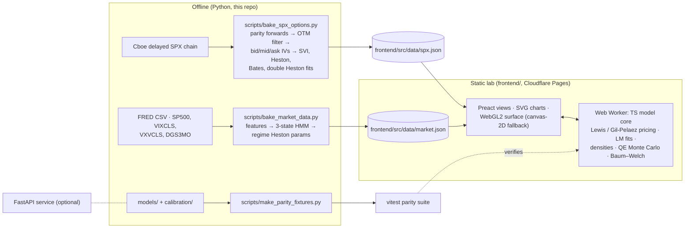
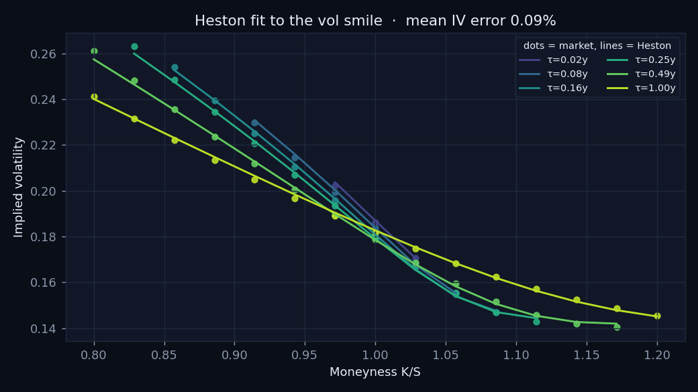
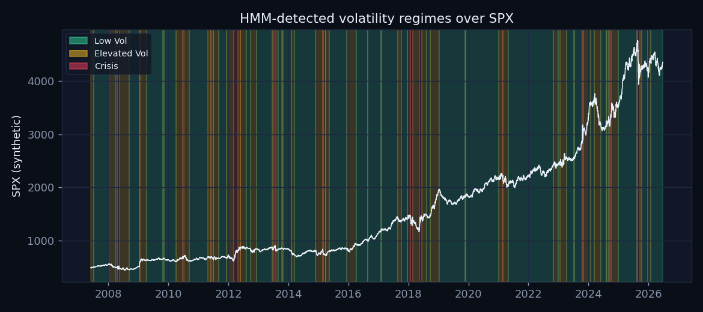
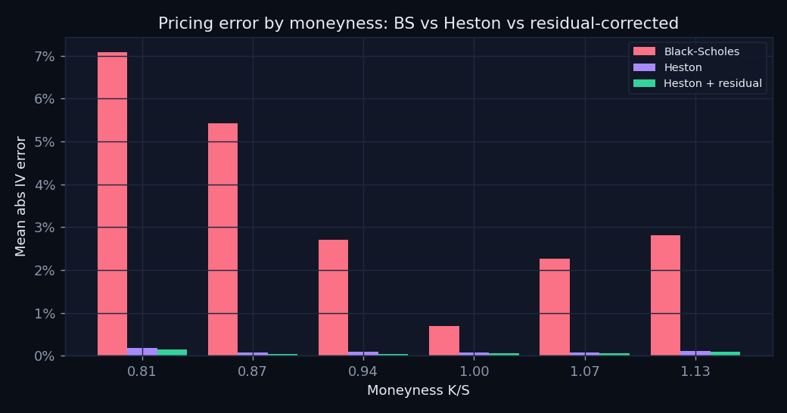
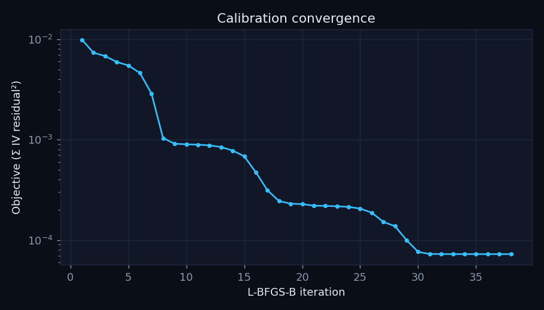

# heston-regime-lab

[](https://github.com/austxu/heston-regime-lab/actions/workflows/ci.yml)
[](https://github.com/austxu/heston-regime-lab/actions/workflows/deploy.yml)


Stochastic-volatility research lab: calibrate **Heston**, **Bates** and **double Heston**
to a real S&P 500 option chain, read the risk-neutral densities it implies, detect market
**regimes** with a hidden Markov model, and study how Heston parameters change across
regimes. The Python package holds the research code and an optional FastAPI service; the
public demo is a **fully static browser lab** that runs a TypeScript port of the same math.

**Live lab:** [heston.austxu.dev](https://heston.austxu.dev). Static files only, no server.
Add `?embed=1` for an iframe layout without page chrome, or `?embed=1&autoplay=1` for an
attract loop that rotates the surface and sweeps parameters until the visitor interacts.

## Architecture



- **TypeScript math core** (`frontend/src/math/`) ports the little-trap characteristic
  function, Gil-Pelaez / Gauss-Legendre pricing (128 nodes, U = 200 as in
  `configs/base.yaml`), Black-Scholes + Brent implied vols, and calibration. In the browser,
  calibration uses bounded Levenberg–Marquardt on the same IV objective and box as the
  Python L-BFGS-B. vitest checks the port against fixtures generated by the Python modules:
  characteristic-function values agree to ~1e-14 (relative), prices to ~1e-11 and implied
  vols to ~1e-9. The synthetic round trip recovers the ground truth within 1%. On every
  regime surface LM reaches the same optimum as L-BFGS-B (parameters within ~5e-5 relative)
  in 7–9 iterations, against ~30. For the real-market models the port matches numpy to
  ~1e-15 (characteristic functions), ~3e-14 (Lewis prices), ~7e-12 (implied vols) and
  ~1e-13 (densities), and on the SPX snapshot the browser LM reaches scipy's optimum for all
  three models (Heston in ~0.3 s, Bates ~1.7 s, double Heston ~1.2 s).
- **Real option quotes.** `scripts/bake_spx_options.py` (`make bake-options`) reads Cboe's
  public delayed SPX/SPXW chain, fits put–call parity per expiry for the forward and
  discount factor, keeps two-sided OTM quotes with spreads under 35% of mid, thins to 21
  strikes on each of 12 expiries (one week to two years) and stores bid/mid/ask Black
  implied vols. Only derived values are committed (`frontend/src/data/spx.json`, 18 KB),
  with the quote timestamp. The current snapshot is the 5 Nov 2026 close (SPX −4.4% that day).
- **More models, honestly compared** (`calibration/market.py`, `models/bates.py`,
  `models/double_heston.py`, `models/svi.py`, `models/fourier.py`). Forward-normalised
  Lewis (2001) pricing on a three-panel Gauss–Legendre rule sized per expiry (accurate to
  ~1e-11 in implied vol even at the vol-of-vol of 4–6 real fits need). On the snapshot's 252
  quotes (RMSE of mid IVs, share of model IVs inside the bid–ask):

  | model | params | RMSE, vol pts | inside bid–ask | ≤ 1 month | ≥ 1 year |
  |---|---|---|---|---|---|
  | Black–Scholes, ATM vol per expiry | 12 | 10.29 | — | — | — |
  | Heston | 5 | 1.07 | 12% | 1.61 | 1.02 |
  | Bates (Heston + Merton jumps) | 8 | 0.98 | 11% | 1.55 | 0.81 |
  | Double Heston | 10 | **0.46** | 31% | 0.67 | 0.22 |
  | SVI per expiry, arbitrage-constrained | 60 | 0.22 | 38% | — | — |

  A second variance factor cuts Heston's error 2.3×; Merton jumps barely help on this
  snapshot (the jump fit degenerates to frequent small jumps at its λ bound). SVI is a
  smoothing benchmark with no dynamics, constrained so its densities are real densities
  (vertex inside the quotes, Lee's wing bound, g(k) ≥ 0).
- **Risk-neutral densities.** Breeden–Litzenberger from the SVI slices and from raw quote
  butterflies, against each model's Fourier-inverted density; implied skewness and
  kurtosis term structures and tail probabilities.
- **History data, baked at build time.** Daily S&P 500, VIX, VIX3M and 3-month T-bill
  history from FRED. The repo's HMM (`models/hmm.py`, `data/features.py`) is fitted
  offline. Regime-conditional Heston parameters come from the VIX term structure and VIX
  dynamics on each regime's days (a proxy, compared in the UI with the option-implied fit).
- **Graphics without libraries.** A WebGL2 surface (Catmull-Rom-refined mesh, Blinn-Phong
  lighting, analytic grid lines, a projected IV contour map on the floor, depth-tested
  quotes with residual stems) layered between canvas-2D axes and labels; the original
  canvas-2D painter is the fallback when WebGL2 is unavailable or the context is lost.
  Monte Carlo fans are shaded by the per-date density of all simulated paths.

### Browser lab views

| Tab | What it does |
|---|---|
| 01 Surface | Sliders for κ, θ, σ, ρ, v₀, r reprice the whole surface in a worker (draft then fine). Shows a Feller indicator, smile slices, ATM term structure and a plain-language note for each parameter. |
| 02 Market | Heston, Bates or double Heston on the real SPX snapshot: the offline scipy fit, or a live LM calibration replayed iteration by iteration. 3D surface with quotes and residual stems, bid–ask smiles per expiry, fit error by expiry, a residual heat map in half-spreads and the model comparison table. |
| 03 Density | Risk-neutral densities per expiry (market via SVI, raw butterflies, each model, lognormal), linear or log scale, tail probabilities, and implied skewness / kurtosis term structures. |
| 04 Regimes | SPX (log) and VIX with HMM regime shading, a crosshair readout, a posterior strip, per-regime stats, the transition matrix and regime Heston parameters next to the option-implied fit. K = 2 and K = 4 refit in the browser. |
| 05 Paths | Heston QE Monte Carlo fan charts for price and volatility, shaded by path density, the terminal distribution against a lognormal, and martingale and MC-vs-Fourier sanity checks. |
| 06 Model | Explainer with MathML equations, parity numbers and data provenance. |

## Research code

The Python package holds the research: the Heston characteristic function, Gil-Pelaez /
Gauss-Legendre pricing, Black-Scholes and implied vol, L-BFGS-B calibration with
round-trip validation, yfinance/FRED data with a deterministic synthetic fallback, vol
features, the 3-state Gaussian HMM, an XGBoost residual model, and Kruskal-Wallis
regime analysis. A hardened FastAPI + Redis + WebSocket service exposes them (rate limits,
gzip, timeouts, JSON logs, Sentry, CI/CD). That service is optional: the lab does not call
it. See [DEPLOY.md](DEPLOY.md) to run it.

## Prerequisites

- Python 3.12, Node.js 22, and npm
- `libomp` on macOS (`brew install libomp`) so XGBoost can load
- Docker with Compose v2 only if you want to run the containerized stack

## Quickstart

```bash
python3.12 -m venv .venv
source .venv/bin/activate
python -m pip install --upgrade pip
python -m pip install -r requirements-dev.txt

# Deterministic checks: tests never need market-data or Redis access.
HRL_OFFLINE=1 REDIS_URL= python -m pytest -q
ruff check .
python -m calibration.validators      # round-trip calibration demo

# Run the API (offline / synthetic data, no network needed):
HRL_OFFLINE=1 uvicorn api.main:app --reload
# Open http://localhost:8000/docs and http://localhost:8000/health

# Or run the full stack. Compose defaults to deterministic synthetic data:
docker compose up --build       # dashboard :3000, api :8000, Redis :6379
# Opt into live requests with: HRL_OFFLINE=0 docker compose up --build
# Optional local settings can be copied from .env.example to .env.

# Browser lab (static; needs no backend):
cd frontend && npm ci && npm run dev            # then open http://localhost:5173
npm test                                        # vitest parity + model tests
npm run build                                   # typecheck + production build -> frontend/dist

# Refresh the baked market data (network) and the parity fixtures:
HRL_OFFLINE=1 python -m scripts.bake_market_data      # -> frontend/src/data/market.json
python -m scripts.bake_spx_options                    # -> frontend/src/data/spx.json (Cboe)
HRL_OFFLINE=1 python -m scripts.make_parity_fixtures  # -> frontend/src/math/__fixtures__/
```

### Deploying the lab

Cloudflare Pages (or any static host): root directory `frontend`, build command
`npm ci && npm run build`, output directory `dist`. `frontend/public/_headers` sets the
CSP, `frame-ancestors` for the austxu.dev embed, and immutable caching for `/assets/*`.
The API, Redis and Railway/Render configuration below are optional and not used by the
lab.

`requirements.txt` contains API/model runtime libraries; `requirements-dev.txt` adds the
test client, chart-generation dependency, pytest, and the pinned linter. `make bootstrap`
installs both Python and frontend dependencies, and `make check` mirrors the main local CI
checks, including both regression suites.

## Layout
```
models/heston.py            Heston char. function + Gil-Pelaez pricing (Gauss-Legendre)
models/black_scholes.py     Black-Scholes pricing + implied-vol inversion (Brent)
models/hmm.py               Gaussian HMM (3 states) + vol-ordered regime labels
models/fourier.py           forward-normalised Lewis pricing, densities, composite quadrature
models/bates.py             Bates (Heston + Merton jumps) characteristic function
models/double_heston.py     two-factor Heston characteristic function
models/svi.py               raw SVI, Gatheral g(k), density, arbitrage-constrained fit
calibration/optimizer.py    L-BFGS-B calibration (+ per-iteration streaming callback)
calibration/market.py       Heston / Bates / double Heston fits to a real snapshot
calibration/validators.py   synthetic data generation + round-trip validation
data/fetchers.py            yfinance/FRED fetchers + deterministic synthetic fallback
data/features.py            realized vol, VIX level/slope, return skew, volume ratio
data/cboe.py                Cboe chain -> parity forwards -> filtered bid/mid/ask IVs
analysis/pricing_comparison.py  BS vs Heston vs XGBoost residual correction
analysis/regime_analysis.py     Kruskal-Wallis + static-vs-regime-conditional calibration
api/                        FastAPI app: routes, services, cache, websocket, schemas,
                            ratelimit, logging_config (gzip/CORS/Sentry in main.py)
frontend/                   static browser lab (Preact + Vite + TS, no runtime deps beyond Preact)
  src/math/                 TS port: heston, black_scholes, lm, calibrate, fourier, models
                            (Bates, double Heston), market, svi, surface, hmm, montecarlo
  src/worker/               Web Worker running all numerics + latest-wins client
  src/render/               3D surface: WebGL2 layer (glSurface.ts) + canvas-2D renderer/fallback
  src/views/                Surface, Market, Density, Regimes, Paths, Model
  src/data/market.json      baked FRED history, HMM regimes, regime params
  src/data/spx.json         baked SPX option snapshot (derived IVs) + reference fits
scripts/                    bake_market_data.py, bake_spx_options.py, make_parity_fixtures.py
visualization/plots.py      diagnostic charts -> docs/assets/ (README figures)
docker/                     Dockerfile.api, Dockerfile.frontend, nginx.conf
docker-compose.yml          frontend + api + redis stack
railway.json, frontend/railway.json   Railway config-as-code; see DEPLOY.md
.github/workflows/          ci.yml (lint + tests + builds), deploy.yml (Railway)
configs/base.yaml           all hyperparameters
tests/                      deterministic pytest unit, contract, API, and hardening suites
```

The mathematical derivations (characteristic function, Gil-Pelaez inversion, HMM) are in
[Mathematical background](#mathematical-background) below; the API and dashboard follow.

## API (Phase 2)

A FastAPI backend serves the research live. Market-derived responses carry a `provenance` block
(`source: live|synthetic`, `as_of`, `stale`, `cache_backend`). Results are cached in Redis
(falling back to an in-process cache) with per-session keys that roll over after market
close, and a serve-stale-on-error policy: if a live yfinance/FRED pull fails, the last good
value is returned flagged `stale`, and only if nothing is cached do we fall back to
deterministic synthetic data.

| Method | Path | Purpose |
|---|---|---|
| GET | `/health` | Liveness, cache backend, redis health |
| GET | `/api/calibration/run` | Calibrate Heston to the live SPX surface (κ, θ, σ, ρ, v₀ + fit error) |
| POST/GET | `/api/calibration/jobs[/{id}]` | Queue/poll a long calibration (`BackgroundTasks`) |
| GET | `/api/surface` | Market & Heston IV grids (moneyness × maturity) for a 3D chart |
| GET | `/api/regime/current` | Current regime + posteriors (cached HMM inference, sub-200ms) |
| GET | `/api/regime/history` | Full regime path over SPX price (`?downsample=`) |
| GET | `/api/regime/parameters` | Kruskal-Wallis across regimes + static-vs-regime accuracy (heavy → 202 + background) |
| GET | `/api/comparison` | Flat-BS vs Heston vs Heston+residual error, by strike/maturity |
| WS | `/ws/calibration` | Live L-BFGS-B convergence stream (`iteration`, `loss`, `params`) |

Add `?live=false` to market-data endpoints (or set `HRL_OFFLINE=1`) to select the synthetic
path. An explicit query parameter takes precedence over the environment default.
Interactive docs at `/docs`; set `FRED_API_KEY` to enable the live risk-free rate.

## Browser lab (replaces the Phase 3 dashboard)

The original React + Plotly dashboard depended on the API, so on a sleeping free-tier host
visitors saw cold-start skeletons, and without WebGL the surface would not draw. It has
been replaced by the static lab described at the top: instant, server-free and
WebGL-free. The bundle is ~39 KB gzipped of JS for the app, a ~8 KB worker and a ~56 KB
lazily loaded data chunk, down from ~667 KB gzipped of JS for the Plotly build.
Deep links: `#surface`, `#calibration`, `#regimes`, `#paths`, `#model`.
`prefers-reduced-motion` disables auto-rotation, inertia, replays and morphing.

## Results

Charts below are regenerated from the offline pipeline with `python -m visualization.plots`.

**Heston fit to the SPX vol smile** — Heston bends to the market smile/skew across
maturities; mean implied-vol error ≈ 0.1% on the synthetic surface (target < 3%).



**Volatility regimes over SPX** — a 3-state Gaussian HMM separates calm / elevated / crisis
regimes (states ordered by realized vol); crises cluster around drawdowns.



**Pricing error by moneyness** — calibrated Heston roughly halves at-the-money error versus
flat Black-Scholes; an out-of-fold XGBoost residual model trims the remaining structured
error. Kruskal-Wallis confirms σ, ρ and v₀ differ significantly across regimes (p < 0.01),
and regime-conditional calibration beats a single static fit.



**Calibration convergence** — L-BFGS-B drives the IV-space objective down many orders of
magnitude in a few dozen iterations (streamed live over `/ws/calibration`).



## Production & deployment

The API is hardened for production: per-client **rate limiting** on the calibration endpoint
(1/min), **gzip** compression, **request timeouts** on live data with cache/synthetic
fallback, **structured JSON logging** with request IDs, and optional **Sentry** error
tracking (enabled by `SENTRY_DSN`). GitHub Actions can deploy to **Railway** after a green
default-branch build once its project token is configured (API + managed Redis + frontend
behind nginx). See
[DEPLOY.md](DEPLOY.md) for the full setup.

## Mathematical background

All formulas below are implemented in `models/` and `calibration/`; the code comments
cross-reference these derivations.

### 1. The Heston model

Under the risk-neutral measure $\mathbb{Q}$ the spot $S_t$ and its instantaneous
variance $v_t$ follow

$$
\begin{aligned}
dS_t &= (r-q)\,S_t\,dt + \sqrt{v_t}\,S_t\,dW_t^{S},\\
dv_t &= \kappa(\theta - v_t)\,dt + \sigma\sqrt{v_t}\,dW_t^{v},\\
d\langle W^{S}, W^{v}\rangle_t &= \rho\,dt,
\end{aligned}
$$

with $\kappa$ (mean-reversion speed), $\theta$ (long-run variance), $\sigma$ (vol of
vol), $\rho$ (correlation) and $v_0$ (initial variance). The variance is a CIR /
square-root process; it stays strictly positive when the **Feller condition**
$2\kappa\theta > \sigma^2$ holds.

### 2. Characteristic function of the log-price

Let $x_t=\ln S_t$. By Itô, $dx_t=(r-q-\tfrac12 v_t)\,dt+\sqrt{v_t}\,dW_t^S$. The
conditional characteristic function $\phi(u;\tau)=\mathbb{E}\!\left[e^{iu x_T}\mid x_t,v_t\right]$,
$\tau=T-t$, is **affine** in $(x_t,v_t)$:

$$
\phi(u;\tau)=\exp\big(C(u,\tau)+D(u,\tau)\,v_t+iu\,x_t\big).
$$

Substituting into the Feynman–Kac PDE turns it into a Riccati system for $C,D$ whose
closed-form solution is, writing the **little-trap** branch (Albrecher et al. 2007),

$$
d=\sqrt{(\rho\sigma iu-\kappa)^2+\sigma^2(iu+u^2)},\qquad
g=\frac{\kappa-\rho\sigma iu-d}{\kappa-\rho\sigma iu+d},
$$

$$
\phi(u;\tau)=\exp\Bigg(
iu\big(\ln S_0+(r-q)\tau\big)
+\frac{\kappa\theta}{\sigma^2}\Big[(\kappa-\rho\sigma iu-d)\tau-2\ln\frac{1-g e^{-d\tau}}{1-g}\Big]
+\frac{v_0}{\sigma^2}(\kappa-\rho\sigma iu-d)\frac{1-e^{-d\tau}}{1-g e^{-d\tau}}
\Bigg).
$$

**Why the trap.** The original Heston (1993) form uses $g^{-1}$ together with
$e^{+d\tau}$. Because $\operatorname{Re}(d)>0$ that factor *overflows* for long
maturities and the complex logarithm $\ln(1-g^{-1}e^{+d\tau})$ crosses a branch cut,
producing discontinuities in the integrand. The trap form above uses $e^{-d\tau}\to0$,
so $1-g e^{-d\tau}\to1$ stays on the principal branch — analytically identical, but
numerically stable. (See `models/heston.py`; this is the "fix numerical instability"
step in the git history.) A self-consistency check is the martingale identity
$\phi(-i)=\mathbb{E}[S_T]=S_0 e^{(r-q)\tau}$.

### 3. Gil-Pelaez Fourier inversion → option price

Gil-Pelaez (1951) recovers a probability directly from the characteristic function
without forming the density. For any random variable $X$ with CF $\phi$,

$$
\mathbb{P}(X>a)=\frac12+\frac1\pi\int_0^\infty
\operatorname{Re}\!\left[\frac{e^{-iua}\,\phi(u)}{iu}\right]du.
$$

A European call has the discounted-payoff decomposition

$$
C = e^{-r\tau}\,\mathbb{E}^{\mathbb{Q}}\big[(S_T-K)^+\big]
  = S_0 e^{-q\tau}\,\Pi_1 - K e^{-r\tau}\,\Pi_2,
$$

where $\Pi_2=\mathbb{Q}(S_T>K)$ is the risk-neutral exercise probability and $\Pi_1$
is the same event under the **stock-as-numéraire** measure, whose characteristic
function is the Esscher-tilted $\phi_1(u)=\phi(u-i)/\phi(-i)$ with forward
$F=\phi(-i)=S_0 e^{(r-q)\tau}$. Applying Gil-Pelaez to each (with $a=\ln K$):

$$
\Pi_2=\frac12+\frac1\pi\int_0^\infty\operatorname{Re}\!\left[\frac{e^{-iu\ln K}\phi(u)}{iu}\right]du,
\qquad
\Pi_1=\frac12+\frac1\pi\int_0^\infty\operatorname{Re}\!\left[\frac{e^{-iu\ln K}\phi(u-i)}{iu\,F}\right]du.
$$

The put follows from put–call parity $C-P=S_0e^{-q\tau}-Ke^{-r\tau}$.

### 4. Gauss-Legendre quadrature

The semi-infinite integrals are truncated at $U$ and evaluated with an $n$-point
Gauss-Legendre rule. Mapping the canonical nodes $t_k\in(-1,1)$ to $(0,U)$ via
$u_k=\tfrac{U}{2}(t_k+1)$ with weights $\tfrac{U}{2}w_k$,

$$
\int_0^U f(u)\,du\;\approx\;\frac{U}{2}\sum_{k=1}^{n} w_k\, f\!\left(u_k\right).
$$

Gauss-Legendre is exact for polynomials of degree $\le 2n-1$ and converges
geometrically for the smooth, exponentially-decaying Heston integrand. The integrand
has a *removable* $1/(iu)$ singularity at $u=0$; because Legendre nodes are strictly
interior, $u=0$ is never sampled, so no special handling is needed.

### 5. Black-Scholes baseline & implied vol

With constant volatility, $C=S_0e^{-q\tau}N(d_1)-Ke^{-r\tau}N(d_2)$,
$d_{1,2}=\frac{\ln(S_0/K)+(r-q\pm\frac12\sigma^2)\tau}{\sigma\sqrt\tau}$. The price is
strictly increasing in $\sigma$ (vega $=S_0e^{-q\tau}\varphi(d_1)\sqrt\tau>0$), so the
**implied volatility** — the $\sigma$ solving $\mathrm{BS}(\sigma)=\text{price}$ — is
unique and found by Brent's method (`scipy.optimize.brentq`).

### 6. Calibration as nonlinear least squares

Calibration is the inverse problem

$$
p^\star=\arg\min_{p}\ \sum_i w_i\big(\mathrm{IV}_{\text{model}}(p;K_i,\tau_i)-\mathrm{IV}_{\text{mkt}}(K_i,\tau_i)\big)^2,
\qquad p=(\kappa,\theta,\sigma,\rho,v_0),
$$

solved with box-constrained quasi-Newton **L-BFGS-B**. Parameters are mapped affinely
to $[0,1]^5$ before optimisation so their disparate magnitudes do not distort the
finite-difference gradients, and a soft penalty on $\max(0,\sigma^2-2\kappa\theta)$ can
discourage Feller violations. Phase 1 proves the whole stack on synthetic data:
generate IVs from known $p_{\text{true}}$, calibrate back, and require recovery within
1% — achieved to $\sim$0.005% (`tests/test_synthetic.py`).

### 7. HMM regime formulation

A Gaussian hidden Markov model has discrete latent regimes $z_t\in\{1,\dots,K\}$
($K=3$) with transition matrix $A_{ij}=\mathbb{P}(z_{t+1}=j\mid z_t=i)$, initial
distribution $\pi$, and Gaussian emissions of the vol-feature vector
$x_t\mid z_t=k\sim\mathcal{N}(\mu_k,\Sigma_k)$. The joint likelihood is

$$
p(x_{1:T},z_{1:T})=\pi_{z_1}\prod_{t=2}^{T}A_{z_{t-1}z_t}\prod_{t=1}^{T}\mathcal{N}(x_t;\mu_{z_t},\Sigma_{z_t}).
$$

Parameters are fit by Baum–Welch (EM); the most-likely regime path is decoded by
Viterbi and per-day posteriors $\mathbb{P}(z_t=k\mid x_{1:T})$ come from forward–backward.
hmmlearn assigns states arbitrarily, so we relabel them by mean realized volatility
(0 = calm, $K{-}1$ = crisis) for stable, interpretable labels. We then test whether
calibrated Heston parameters differ across regimes (Kruskal–Wallis, $p<0.01$) and compare
static vs regime-conditional calibration. Implemented in `models/hmm.py` and
`analysis/regime_analysis.py`, served via `/api/regime/*`.
