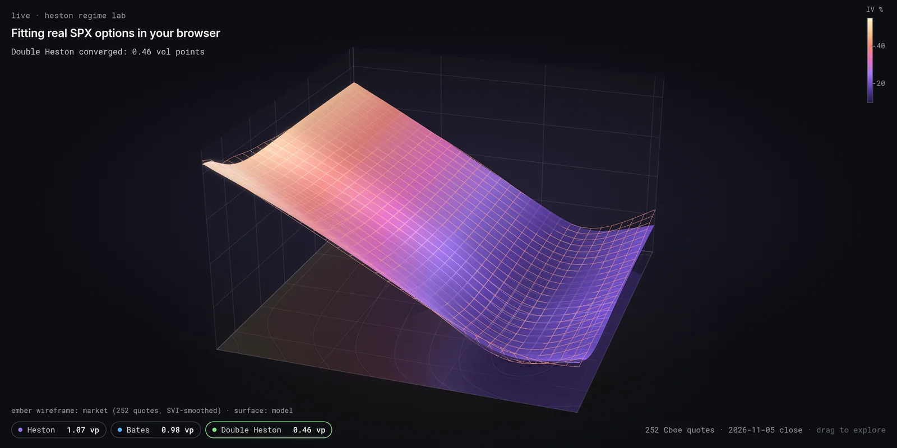
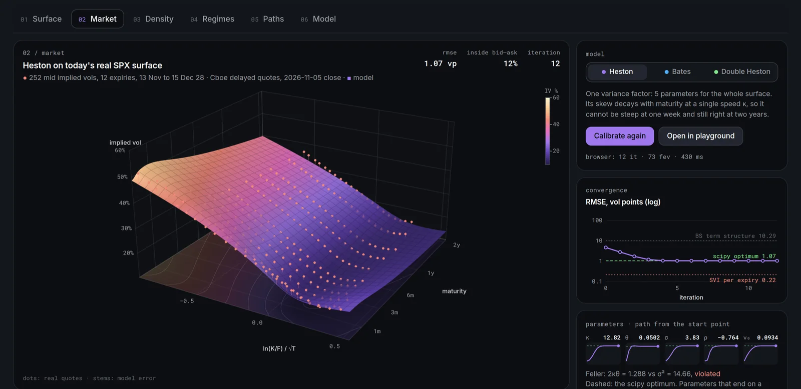
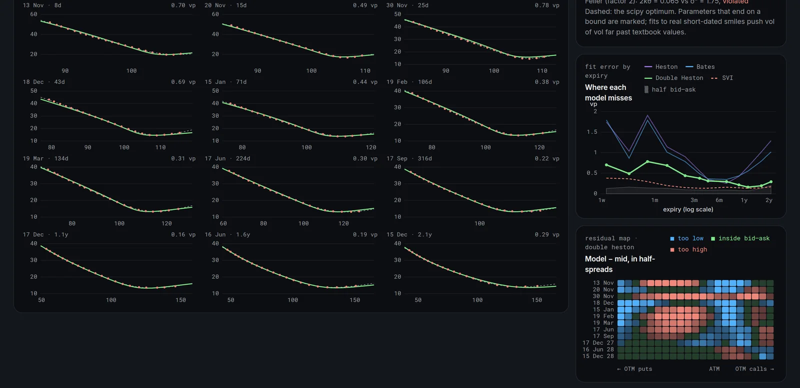
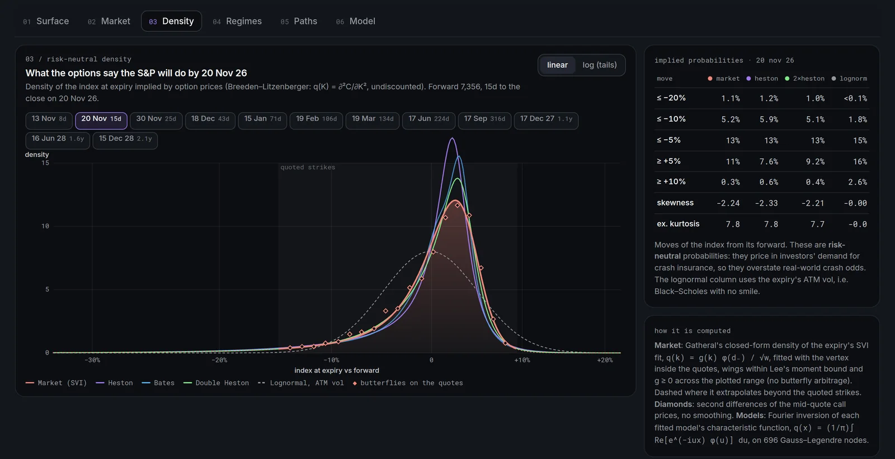
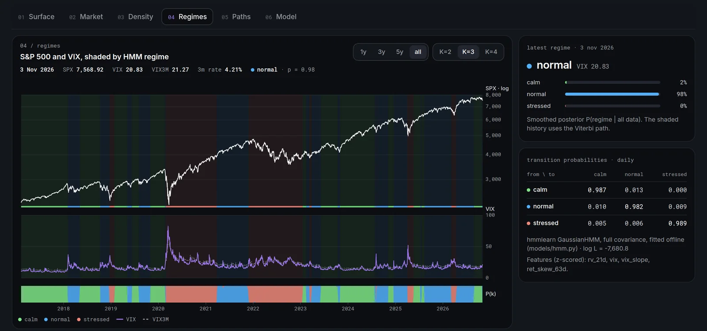
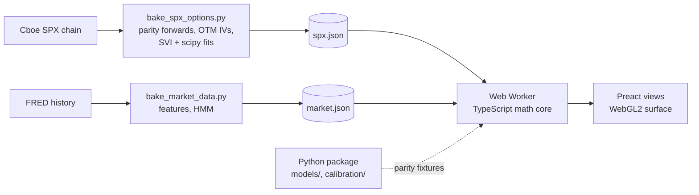

# Heston Regime Lab

Stochastic-volatility models fitted live, in the browser, to a real S&P 500 option chain.

**Try it → [heston.austxu.dev](https://heston.austxu.dev)**

[](https://heston.austxu.dev)

The lab calibrates Heston, Bates and a two-factor Heston to 252 Cboe SPX quotes, shows the
crash risk those prices imply, and relates a decade of index and VIX history to model
regimes. All of it runs client-side: a TypeScript port of the Python research code, checked
against it in tests, running in a Web Worker and drawn with WebGL2. There is no server.

## What it shows

[](https://heston.austxu.dev/#market)

**Market.** Pick a model and watch the Levenberg–Marquardt fit converge on the real
surface. Dots are quotes, stems are the model's error, and the scipy optimum is drawn for
comparison.

[](https://heston.austxu.dev/#market)

Bid–ask smiles for all 12 expiries, fit error by expiry for every model, and a residual
map in units of the half bid–ask spread.

[](https://heston.austxu.dev/#density)

**Density.** Risk-neutral densities (Breeden–Litzenberger) from the market and from each
model, with tail probabilities. For the 20 Nov 2026 expiry the market prices a 5.2% chance
of a fall of 10% or more, against 1.8% under lognormal Black–Scholes.

[](https://heston.austxu.dev/#regimes)

**Regimes.** A 3-state Gaussian HMM fitted to 2,448 trading days of FRED data (S&P 500,
VIX, VIX3M, T-bill), with per-regime Heston parameters next to the option-implied fit.
Surface and Paths tabs (a parameter playground and QE Monte Carlo) complete the lab.

## Results

Snapshot: Cboe delayed quotes at the 5 Nov 2026 close (SPX 7,353.73, down 4.4% that day).
252 out-of-the-money quotes on 12 expiries from 8 days to 2.1 years. RMSE is over mid
implied vols, in vol points.

| Model | Params | RMSE (vp) | Inside bid–ask | ≤ 1 month | ≥ 1 year |
|---|---|---|---|---|---|
| Black–Scholes | 12 | 10.29 | — | — | — |
| Heston | 5 | 1.07 | 12% | 1.61 | 1.02 |
| Bates (Heston + jumps) | 8 | 0.98 | 11% | 1.55 | 0.81 |
| **Double Heston** | 10 | **0.46** | 31% | 0.67 | 0.22 |
| SVI, per expiry | 60 | 0.22 | 38% | 0.35 | 0.15 |

The Black–Scholes baseline is one flat vol per expiry (its ATM vol). A second variance
factor cuts Heston's error 2.3×; Merton jumps barely help on this snapshot. SVI is a
smoothing benchmark with no dynamics, constrained to be free of butterfly arbitrage.

- **Same optimum in the browser.** From the same start, the TypeScript Levenberg–Marquardt
  fit matches scipy's RMSE to four significant figures: about 0.13 s for Heston, 0.8 s for
  Bates and 0.6 s for double Heston (Node, vitest). On the live page, which also re-prices
  the 3D surface every iteration, the Heston fit finishes in about 0.4 s.
- **Parity with Python.** TypeScript and numpy agree to 1e-11 in implied vol (6.7e-12),
  2.6e-14 in price and 1.3e-15 in the characteristic function.
- **Round trip.** On a clean synthetic surface, calibration recovers all five Heston
  parameters to within 1.3e-4 % of the truth.
- **Tests.** 138 pytest and 34 vitest tests, including the parity suite.

## Architecture



The Python package (`models/`, `calibration/`, `data/`) is the reference implementation:
Heston, Bates and double Heston characteristic functions, forward-normalised Lewis pricing,
SVI, calibration, the HMM, and the bake scripts that turn public data into two small JSON
files. The browser lab ports the numerics to TypeScript and runs them in a Web Worker:
pricing, calibration, densities, Monte Carlo and Baum–Welch. A vitest suite checks every
ported function against fixtures generated from the Python code. The 3D surface is a WebGL2
layer (bloom, reflections and a wireframe target in the attract loop) over canvas-2D axes,
with a canvas-2D fallback. The initial bundle is about 45 KB of gzipped JS.

A FastAPI + Redis service in `api/` exposes the same research over HTTP and WebSocket. It is
optional and the live lab does not use it.

**The model.** Heston lets variance follow its own mean-reverting square-root process,
correlated with the index. That produces the equity skew and a term structure of vol.
Prices come from its closed-form characteristic function by Fourier inversion. Derivations
are in [docs/MATH.md](docs/MATH.md).

**Data terms.** Cboe allows personal viewing of its delayed quotes. Only derived values
(implied vols, forwards, fits) are committed, and the snapshot is re-baked by hand.

## Run it locally

```bash
cd frontend && npm ci && npm run dev   # lab at http://localhost:5173
npm test                               # vitest: parity and model tests
pip install -r requirements-dev.txt && HRL_OFFLINE=1 REDIS_URL= python -m pytest -q
```

Prerequisites, the full command list, the code layout, the API reference and deployment
notes are in [docs/DEVELOPMENT.md](docs/DEVELOPMENT.md).
