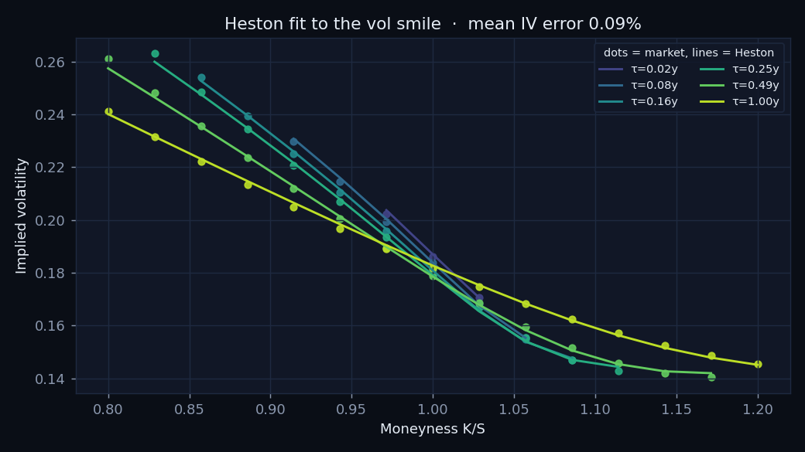
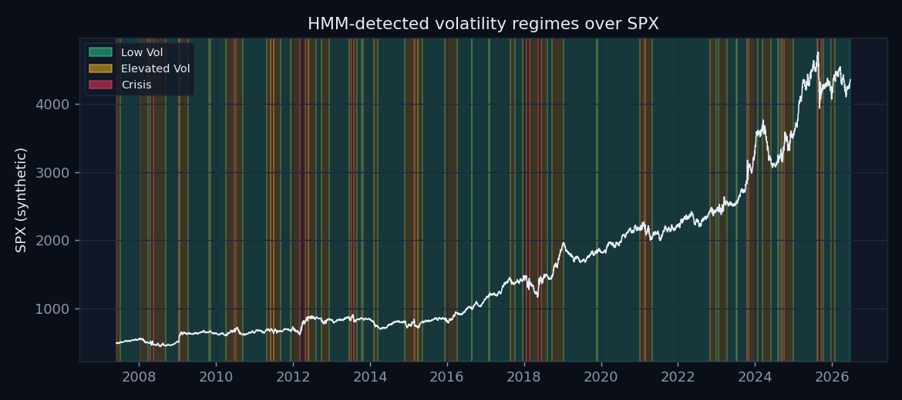
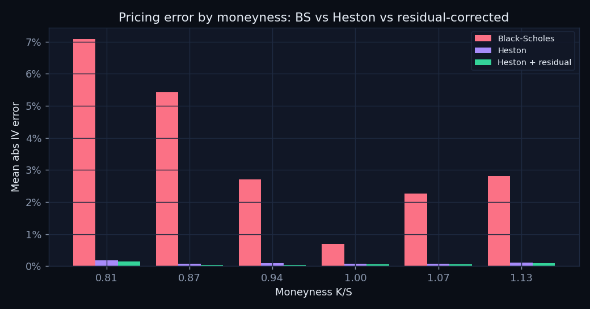
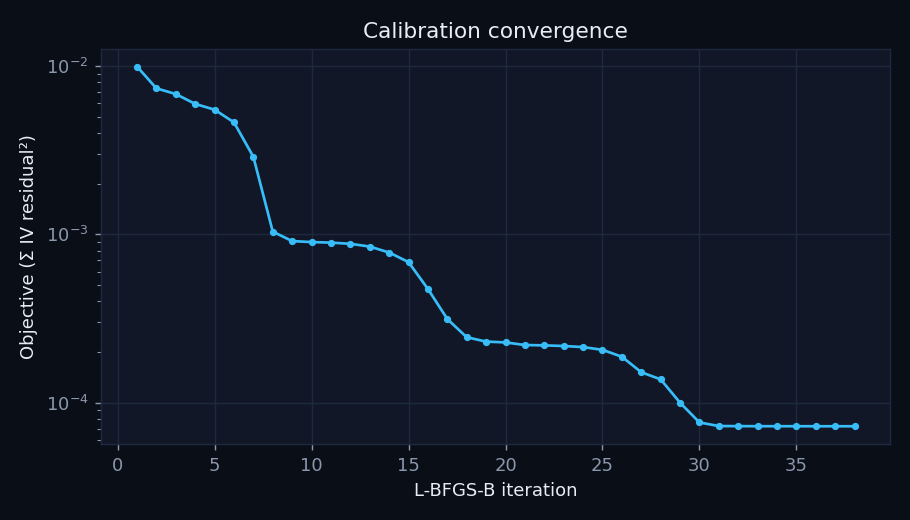

# Development

Everything needed to run, test and deploy the repository. The [README](../README.md)
covers what the project does and its results; [MATH.md](MATH.md) has the derivations.

## Prerequisites

- Python 3.12, Node.js 22, and npm
- `libomp` on macOS (`brew install libomp`) so XGBoost can load
- Docker with Compose v2 only if you want to run the containerized stack

## Quickstart

```bash
python3.12 -m venv .venv
source .venv/bin/activate
python -m pip install --upgrade pip
python -m pip install -r requirements-dev.txt

# Deterministic checks: tests never need market-data or Redis access.
HRL_OFFLINE=1 REDIS_URL= python -m pytest -q
ruff check .
python -m calibration.validators      # round-trip calibration demo

# Run the API (offline / synthetic data, no network needed):
HRL_OFFLINE=1 uvicorn api.main:app --reload
# Open http://localhost:8000/docs and http://localhost:8000/health

# Or run the full stack. Compose defaults to deterministic synthetic data:
docker compose up --build       # dashboard :3000, api :8000, Redis :6379
# Opt into live requests with: HRL_OFFLINE=0 docker compose up --build
# Optional local settings can be copied from .env.example to .env.

# Browser lab (static; needs no backend):
cd frontend && npm ci && npm run dev            # then open http://localhost:5173
npm test                                        # vitest parity + model tests
npm run build                                   # typecheck + production build -> frontend/dist

# Refresh the baked market data (network) and the parity fixtures:
HRL_OFFLINE=1 python -m scripts.bake_market_data      # -> frontend/src/data/market.json
python -m scripts.bake_spx_options                    # -> frontend/src/data/spx.json (Cboe)
HRL_OFFLINE=1 python -m scripts.make_parity_fixtures  # -> frontend/src/math/__fixtures__/
```

## Deploying the lab

Cloudflare Pages (or any static host): root directory `frontend`, build command
`npm ci && npm run build`, output directory `dist`. `frontend/public/_headers` sets the
CSP, `frame-ancestors` for the austxu.dev embed, and immutable caching for `/assets/*`.
The API, Redis and Railway/Render configuration below are optional and not used by the
lab.

`requirements.txt` contains API/model runtime libraries; `requirements-dev.txt` adds the
test client, chart-generation dependency, pytest, and the pinned linter. `make bootstrap`
installs both Python and frontend dependencies, and `make check` mirrors the main local CI
checks, including both regression suites.

## Browser lab notes

The lab is fully static: no API calls at runtime. It replaced an earlier React + Plotly
dashboard that depended on the API (about 667 KB gzipped of JS). The initial bundle is now
about 45 KB gzipped of JS; the worker, the FRED history and the option snapshot (with the
Market and Density views) load as separate chunks. The 3D surface uses WebGL2 and falls
back to a canvas-2D renderer. Deep links: `#surface`, `#market` (`#calibration` redirects
there), `#density`, `#regimes`, `#paths`, `#model`; `?embed=1` and `?embed=1&autoplay=1`
serve the iframe layout and the attract loop. `prefers-reduced-motion` disables rotation,
inertia, replays and morphing.

The option snapshot is Cboe delayed data. Cboe's site terms allow personal viewing, and
redistribution needs their approval, so only derived values (implied vols, strikes,
parity-implied forwards and discount factors, fits) are committed, and no scheduled job
refreshes them. `make bake-options` re-bakes by hand.

## Layout
```
models/heston.py            Heston char. function + Gil-Pelaez pricing (Gauss-Legendre)
models/black_scholes.py     Black-Scholes pricing + implied-vol inversion (Brent)
models/hmm.py               Gaussian HMM (3 states) + vol-ordered regime labels
models/fourier.py           forward-normalised Lewis pricing, densities, composite quadrature
models/bates.py             Bates (Heston + Merton jumps) characteristic function
models/double_heston.py     two-factor Heston characteristic function
models/svi.py               raw SVI, Gatheral g(k), density, arbitrage-constrained fit
calibration/optimizer.py    L-BFGS-B calibration (+ per-iteration streaming callback)
calibration/market.py       Heston / Bates / double Heston fits to a real snapshot
calibration/validators.py   synthetic data generation + round-trip validation
data/fetchers.py            yfinance/FRED fetchers + deterministic synthetic fallback
data/features.py            realized vol, VIX level/slope, return skew, volume ratio
data/cboe.py                Cboe chain -> parity forwards -> filtered bid/mid/ask IVs
analysis/pricing_comparison.py  BS vs Heston vs XGBoost residual correction
analysis/regime_analysis.py     Kruskal-Wallis + static-vs-regime-conditional calibration
api/                        FastAPI app: routes, services, cache, websocket, schemas,
                            ratelimit, logging_config (gzip/CORS/Sentry in main.py)
frontend/                   static browser lab (Preact + Vite + TS, no runtime deps beyond Preact)
  src/math/                 TS port: heston, black_scholes, lm, calibrate, fourier, models
                            (Bates, double Heston), market, svi, surface, hmm, montecarlo
  src/worker/               Web Worker running all numerics + latest-wins client
  src/render/               3D surface: WebGL2 layer (glSurface.ts) + canvas-2D renderer/fallback
  src/views/                Surface, Market, Density, Regimes, Paths, Model
  src/data/market.json      baked FRED history, HMM regimes, regime params
  src/data/spx.json         baked SPX option snapshot (derived IVs) + reference fits
scripts/                    bake_market_data.py, bake_spx_options.py, make_parity_fixtures.py
visualization/plots.py      diagnostic charts -> docs/assets/ (shown below)
docker/                     Dockerfile.api, Dockerfile.frontend, nginx.conf
docker-compose.yml          frontend + api + redis stack
railway.json, frontend/railway.json   Railway config-as-code; see DEPLOY.md
.github/workflows/          ci.yml (lint + tests + builds), deploy.yml (Railway)
configs/base.yaml           all hyperparameters
tests/                      deterministic pytest unit, contract, API, and hardening suites
```

## Optional API service

A FastAPI backend serves the research live. Market-derived responses carry a `provenance` block
(`source: live|synthetic`, `as_of`, `stale`, `cache_backend`). Results are cached in Redis
(falling back to an in-process cache) with per-session keys that roll over after market
close, and a serve-stale-on-error policy: if a live yfinance/FRED pull fails, the last good
value is returned flagged `stale`, and only if nothing is cached do we fall back to
deterministic synthetic data.

| Method | Path | Purpose |
|---|---|---|
| GET | `/health` | Liveness, cache backend, redis health |
| GET | `/api/calibration/run` | Calibrate Heston to the live SPX surface (κ, θ, σ, ρ, v₀ + fit error) |
| POST/GET | `/api/calibration/jobs[/{id}]` | Queue/poll a long calibration (`BackgroundTasks`) |
| GET | `/api/surface` | Market & Heston IV grids (moneyness × maturity) for a 3D chart |
| GET | `/api/regime/current` | Current regime + posteriors (cached HMM inference, sub-200ms) |
| GET | `/api/regime/history` | Full regime path over SPX price (`?downsample=`) |
| GET | `/api/regime/parameters` | Kruskal-Wallis across regimes + static-vs-regime accuracy (heavy → 202 + background) |
| GET | `/api/comparison` | Flat-BS vs Heston vs Heston+residual error, by strike/maturity |
| WS | `/ws/calibration` | Live L-BFGS-B convergence stream (`iteration`, `loss`, `params`) |

Add `?live=false` to market-data endpoints (or set `HRL_OFFLINE=1`) to select the synthetic
path. An explicit query parameter takes precedence over the environment default.
Interactive docs at `/docs`; set `FRED_API_KEY` to enable the live risk-free rate.

## Production hardening and deployment

The API is hardened for production: per-client rate limiting on the calibration endpoint
(1/min), gzip compression, request timeouts on live data with cache/synthetic fallback,
structured JSON logging with request IDs, and optional Sentry error tracking (enabled by
`SENTRY_DSN`). `.github/workflows/deploy.yml` is wired to deploy the API, Redis and the
old frontend to Railway after a green default-branch build, but it skips unless a
`RAILWAY_TOKEN` secret is configured. No token is set for this repository (its Deploy runs
finish in about ten seconds without deploying), so that service is not running. See
[DEPLOY.md](../DEPLOY.md) for the full setup if you want to run it.

## Offline research charts

Charts from the offline Python pipeline on synthetic surfaces, regenerated with
`python -m visualization.plots`. They predate the real-market fits in the README.

**Heston fit to the SPX vol smile** — Heston bends to the market smile/skew across
maturities; mean implied-vol error ≈ 0.1% on the synthetic surface (target < 3%).



**Volatility regimes over SPX** — a 3-state Gaussian HMM separates calm / elevated / crisis
regimes (states ordered by realized vol); crises cluster around drawdowns.



**Pricing error by moneyness** — calibrated Heston roughly halves at-the-money error versus
flat Black-Scholes; an out-of-fold XGBoost residual model trims the remaining structured
error. Kruskal-Wallis confirms σ, ρ and v₀ differ significantly across regimes (p < 0.01),
and regime-conditional calibration beats a single static fit.



**Calibration convergence** — L-BFGS-B drives the IV-space objective down many orders of
magnitude in a few dozen iterations (streamed live over `/ws/calibration`).


